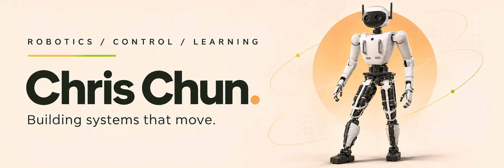

<picture>
  <source media="(prefers-color-scheme: dark)" srcset="assets/alice-hero-dark.png">
  <source media="(prefers-color-scheme: light)" srcset="assets/alice-hero-light.png">
  
</picture>

  <strong>로봇이 더 자연스럽게 움직이도록.</strong>

  <a href="https://github.com/DenverCoder1/readme-typing-svg">
    <picture>
      <source media="(prefers-color-scheme: dark)" srcset="https://readme-typing-svg.demolab.com?font=Fira+Code&amp;weight=500&amp;size=23&amp;duration=2400&amp;pause=1600&amp;color=F2A34F&amp;center=true&amp;vCenter=true&amp;width=520&amp;height=45&amp;lines=Robot+Control+Systems;Humanoid+Locomotion;Reinforcement+Learning">
      
    </picture>
  </a>

  <a href="#research">Research</a> &nbsp;·&nbsp;
  <a href="#toolbox">Toolbox</a> &nbsp;·&nbsp;
  <a href="#activity">Activity</a> &nbsp;·&nbsp;
  <a href="#connect">Connect</a>

## Research

안녕하세요, **Chris Chun**입니다. 로봇 제어 시스템과 휴머노이드 이족보행, 강화학습을 중심으로 연구하고 개발합니다.

- **Robot Control** — 로봇의 움직임을 만드는 제어 시스템
- **Humanoid Locomotion** — 균형을 잡고 자연스럽게 걷는 이족보행
- **Reinforcement Learning** — 경험을 통해 움직임을 학습하는 로봇

## Toolbox

  <a href="https://skillicons.dev">
    <picture>
      <source media="(prefers-color-scheme: dark)" srcset="https://skillicons.dev/icons?i=cpp%2Cc%2Cpython%2Cros%2Cqt%2Clinux%2Cgit%2Ccmake&amp;theme=dark&amp;perline=8">
      
    </picture>
  </a>

Control in C++ · Learning in Python · Robotics with ROS &amp; ROS 2

## Activity

## Connect

[Email ↗](mailto:arirang2067@gmail.com) &nbsp;·&nbsp; [Instagram ↗](https://www.instagram.com/chris_chun_yh) &nbsp;·&nbsp; [GitHub ↗](https://github.com/arirang2067)

 

From control to motion, one step at a time.

