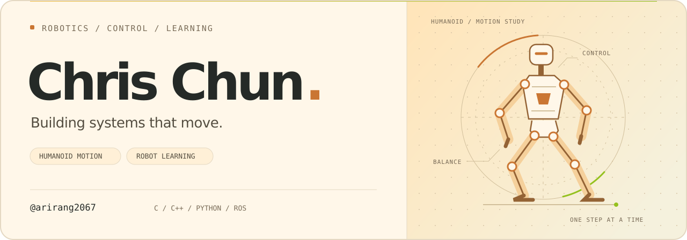

<picture>
  <source media="(prefers-color-scheme: dark)" srcset="assets/profile-dark.svg">
  <source media="(prefers-color-scheme: light)" srcset="assets/profile-light.svg">
  
</picture>

  <strong>로봇이 더 자연스럽게 움직이도록.</strong> 
  Robot Control · Humanoid Locomotion · Reinforcement Learning

  <a href="#research">Research</a> &nbsp;·&nbsp;
  <a href="#selected-work">Selected Work</a> &nbsp;·&nbsp;
  <a href="#toolbox">Toolbox</a> &nbsp;·&nbsp;
  <a href="#connect">Connect</a>

## Research

안녕하세요, **Chris Chun**입니다. 로봇 제어 시스템과 휴머노이드 이족보행, 강화학습을 중심으로 연구하고 개발합니다.

- **Robot Control** — 로봇의 움직임을 만드는 제어 시스템
- **Humanoid Locomotion** — 균형을 잡고 자연스럽게 걷는 이족보행
- **Reinforcement Learning** — 경험을 통해 움직임을 학습하는 로봇

## Selected Work

<table>
  <tr>
    <td width="50%" valign="top">
      <h3><a href="https://github.com/arirang2067/tutorial_mobile_robot">Mobile Robot ↗</a></h3>
      
ROS 2 기반 모바일 로봇 제어와 시뮬레이션 튜토리얼.

      
<code>ROS 2</code> <code>C++</code> <code>Kinematics</code>

    </td>
    <td width="50%" valign="top">
      <h3><a href="https://github.com/arirang2067/HERoEHS-ALICE-Gazebo-Example">ALICE · Gazebo ↗</a></h3>
      
휴머노이드 ALICE의 Gazebo 시뮬레이션 예제.

      
<code>Humanoid</code> <code>Gazebo</code>

    </td>
  </tr>
  <tr>
    <td width="50%" valign="top">
      <h3><a href="https://github.com/arirang2067/behavior_tree_tutorial">Behavior Tree ↗</a></h3>
      
ROS 환경에서 시작하는 행동 트리 튜토리얼.

      
<code>ROS</code> <code>Behavior Tree</code>

    </td>
    <td width="50%" valign="top">
      <h3><a href="https://github.com/arirang2067/ros_qt_tutorial">ROS × Qt ↗</a></h3>
      
ROS와 Qt를 연결하는 GUI 튜토리얼.

      
<code>ROS</code> <code>Qt</code> <code>C++</code>

    </td>
  </tr>
</table>

[공개 저장소 더 보기 →](https://github.com/arirang2067?tab=repositories)

## Toolbox

| Area | Tools |
| :--- | :--- |
| Languages | `C` · `C++` · `Python` |
| Robotics | `ROS` · <code>ROS&nbsp;2</code> · `Gazebo` |
| Development | `Qt` · `Linux` · `Git` · `GitHub` |

## Connect

[Email ↗](mailto:arirang2067@gmail.com) &nbsp;·&nbsp; [Instagram ↗](https://www.instagram.com/chris_chun_yh) &nbsp;·&nbsp; [GitHub ↗](https://github.com/arirang2067)

 

From control to motion, one step at a time.

